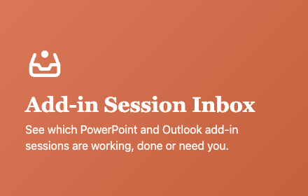
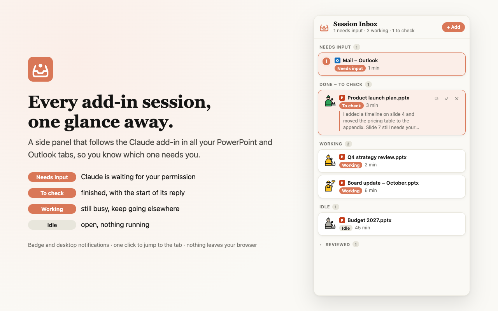
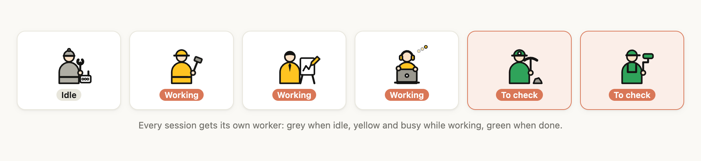

<p align="center">
  
</p>

<p align="center">
  <b>See at a glance which Claude add-in sessions in PowerPoint and Outlook for the web are working, done or waiting for you.</b><br>
  Chrome extension · Windows and macOS · nothing leaves your browser
</p>

---

Running the Claude add-in in three decks and your mailbox at the same time? Instead of clicking through
tabs to see which one is finished, keep **Add-in Session Inbox** open in Chrome's side panel. It follows
every session and tells you which one needs you.



## What you see

| Status | Meaning | What to do |
|---|---|---|
| **Needs input** | Claude is waiting for you: a permission request (e.g. to edit a slide) or a question with options | Click the row and answer in the add-in |
| **Done – to check** | Claude finished. The first lines of its reply are shown | Click the row to review, then ✓ |
| **Working** | Claude is still busy | Carry on elsewhere, you'll be notified |
| **Idle** | The add-in is open, nothing is running | – |
| **Reviewed** | You ticked ✓ on a finished session | Folded away, cleared after 7 days |
| **Unknown** | The add-in can't be read (tab closed, add-in not open, or the add-in changed) | Open the tab and the add-in |

The toolbar icon shows a **badge** with the number of sessions that need you, and a **desktop
notification** pops up when a session finishes or needs input.

<p align="center">
  
</p>

## Install

**Chrome Web Store:** coming soon (unlisted link).

**Until then, install it manually** (takes a minute):

1. Download `add-in-session-inbox-<version>.zip` from the
   [latest release](https://github.com/loicvdk/add-in-session-inbox/releases/latest) and unzip it.
2. Go to `chrome://extensions` and switch on **Developer mode** (top right).
3. Click **Load unpacked** and select the unzipped folder.
4. Click the puzzle piece in the toolbar and **pin** Add-in Session Inbox.
5. Reload any PowerPoint or Outlook tabs that were already open.

## How to use it

1. **Open the panel**: click the inbox icon in the toolbar. The panel stays open while you switch tabs.
2. **Open your decks** in PowerPoint for the web. They show up automatically. Open the Claude add-in in a
   deck (or in Outlook) and its status appears.
3. **Work as usual.** When something changes, you get a badge and a notification.
4. **Click a row** to jump to that tab. If you closed it, it reopens.
5. **Row buttons** (hover a row):
   - **✓**: mark as reviewed
   - **✕**: stop tracking
   - **⧉**: open the deck in the **PowerPoint desktop app** (Windows or Mac). The first time, Chrome asks
     whether to open PowerPoint; tick *Always allow*.
6. **+ Add**: paste any link to open and track it (for example a claude.ai chat). Only PowerPoint and Outlook
   tabs with the add-in get a status; other pages are listed as tabs.

## Tips

- **Keep background tabs awake.** Chrome's Memory Saver can pause tabs you're not looking at, which also
  pauses the add-in. Go to **Settings → Performance → Always keep these sites active** and add
  `[*.]sharepoint.com`, `[*.]officeapps.live.com`, `outlook.office.com` and `pivot.claude.ai`.
- **Background tabs update a bit later.** Chrome slows down tabs that have been hidden for a few minutes,
  so a finished session there can take up to about a minute to show as done. The tab you're looking at
  updates every second.
- **Outlook** gets one row per Outlook tab, whichever email you have open.

## Privacy

The extension reads the add-in's status and the start of Claude's last reply, and keeps them **only in your
browser**. No servers, no analytics, no network requests. Details:
[privacy policy](https://loicvdk.github.io/add-in-session-inbox/privacy.html).

## Questions

**A session shows "Unknown".** Make sure the tab is open and the Claude add-in is open in it. If that
doesn't help, the add-in's page may have changed; please [open an issue](https://github.com/loicvdk/add-in-session-inbox/issues).

**Nothing happens after installing or updating.** Reload the PowerPoint and Outlook tabs. Chrome only
starts the extension in tabs opened or reloaded after the install.

**Does it work with desktop PowerPoint or Outlook?** No, only with the web versions in Chrome.

**Can it open the Claude add-in for me?** No. Only the add-in itself can open automatically.

---

<sub>Not affiliated with or endorsed by Anthropic or Microsoft. Claude is a trademark of Anthropic;
PowerPoint and Outlook are trademarks of Microsoft. They are named only to describe what this tool works with.</sub>

---

## For developers

Plain JavaScript, HTML and CSS, Manifest V3, no build step and no dependencies. The spec is
[`PROJECT_GUIDELINES.md`](PROJECT_GUIDELINES.md); conventions for coding agents are in [`CLAUDE.md`](CLAUDE.md).

```
manifest.json
src/background.js           service worker: rows, badge, notifications, tab matching
src/state.js                storage helpers, app detection, URL normalization
src/selectors.js            every selector for the add-in and PowerPoint page (with check date)
src/content/claude-frame.js runs in the add-in frame: 1 s poll → thinking / input / idle / unknown
src/content/ppt-page.js     runs on deck pages: reads the file address for "Open in desktop app"
sidepanel/                  the panel (index.html, panel.js, panel.css, workers.js)
store/                      Web Store listing text, images and the pages that render them
scripts/package.sh          builds the store zip
```

**Develop:** Load unpacked on this folder. After a change, click reload on the extension card, then
reload the PowerPoint/Outlook tabs (content scripts aren't re-injected into open tabs).

**Debug:** service worker console via `chrome://extensions` → Add-in Session Inbox → *Inspect views:
service worker*. Content script: the tab's DevTools console, with the `pivot.claude.ai` frame picked in
the context dropdown.

### Updating selectors

When the add-in changes and rows go to `unknown`, update [`src/selectors.js`](src/selectors.js):

1. Open a deck with the Claude add-in, open DevTools (`⌥⌘I` on Mac, `Ctrl+Shift+I` on Windows).
2. In the Console, pick the `pivot.claude.ai` frame in the context dropdown (top-left, default "top") and run:

   ```js
   [...document.querySelectorAll('button,[role=button],[aria-busy],[data-testid],[aria-live]')]
     .map(e => [e.tagName, e.getAttribute('aria-label'), e.getAttribute('data-testid'),
                e.getAttribute('aria-busy'), e.className?.toString().slice(0, 60), e.textContent.trim().slice(0, 40)])
   ```

   Run it once while Claude is idle and once while it's thinking. What only appears while thinking
   (today the Stop button) is the `thinking` selector.
3. Update the selectors and the "Last checked" date. If the add-in moved to another address, update
   `content_scripts.matches` in `manifest.json`.

### Release

1. Bump `version` in `manifest.json`.
2. `./scripts/package.sh` → `dist/add-in-session-inbox-<version>.zip`.
3. Upload it in the Chrome Web Store Developer Dashboard and attach it to a GitHub release.

Listing text, privacy-form answers and how to regenerate the images: [`store/listing.md`](store/listing.md).

### Open items

- [ ] Volatile query params in deck URLs (is `?e=` stable per deck?) → `src/state.js`
- [ ] Manual acceptance test (`PROJECT_GUIDELINES.md` §13)
